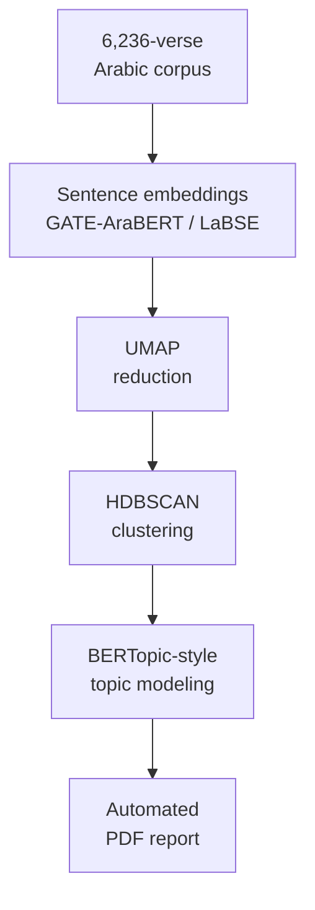

# Unsupervised NLP Topic Modeling for Classical Arabic

!!! abstract "Case Study Summary"
    **Type**: Independent project  
    **Domain**: Natural Language Processing  
    **Corpus**: 6,236 verses of classical Arabic  
    
    **Highlights**:
    
    - Transformer sentence embeddings built for Arabic: **GATE-AraBERT-v1** and **Arabic LaBSE-Matryoshka**
    - **UMAP** dimensionality reduction and **HDBSCAN** density-based clustering
    - **BERTopic-style topic modeling** to name and describe each theme
    - **Automated PDF reporting** that explains the findings to a general audience

Classical Arabic is a hard target for NLP. Its vocabulary, morphology and style differ from the modern text most language models are trained on. I wanted to find out whether an unsupervised pipeline could surface meaningful themes across a full classical corpus, without any labeled data.

## Challenge

- **No labels.** The structure had to emerge from the text itself.
- **Language fit.** Generic multilingual embeddings often miss the nuance of classical Arabic.
- **Explainability.** The output had to make sense to readers who aren't data scientists.

## Approach

I built a multi-phase Python pipeline:

1. **Embedding.** Encode every verse with transformer sentence embeddings tuned for Arabic (GATE-AraBERT-v1 and Arabic LaBSE-Matryoshka) and compare how well each captures meaning.
2. **Dimensionality reduction.** Project the high-dimensional embeddings with UMAP while preserving local structure.
3. **Clustering.** Use HDBSCAN to find clusters of varying density, letting outliers stay outliers instead of forcing them into a group.
4. **Topic modeling.** Apply BERTopic-style class-based term weighting to describe each cluster as an interpretable topic.
5. **Reporting.** Generate PDF reports automatically, so the results can be read by a general audience.

## Solution Overview

## What this demonstrates

- Choosing and evaluating embedding models for a specific, low-resource language domain
- Unsupervised learning end-to-end: representation, reduction, clustering and interpretation
- Turning technical NLP results into material a non-technical audience can read

## Tech Stack

- Python
- Sentence Transformers (GATE-AraBERT-v1, Arabic LaBSE-Matryoshka)
- UMAP
- HDBSCAN
- BERTopic-style topic modeling
- Automated PDF report generation

-   :material-coffee:{ .lg .middle } Let's have a virtual coffee together!

    ---
    
    Want to see if we're a match? Let's have a chat and find out. Schedule a free 30-minute session to discuss your data and AI challenges and explore how we can work together.

    [Book Free Intro Call :material-arrow-top-right:](https://calendly.com/umarvinci/new-meeting){ .md-button .md-button--primary }

