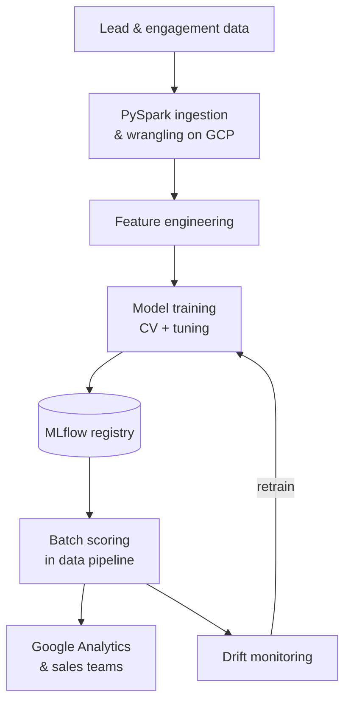

# Predictive Lead Scoring with >$1M Impact

!!! abstract "Case Study Summary"
    **Organization**: Emeritus  
    **Industry**: EdTech / Executive Education  
    **Role**: Senior Data Scientist  
    
    **Impact Metrics**:
    
    - The top 30% of scored leads capture **85% of conversions**
    - More than **$1M in business impact**
    - **16% lift** in lead-to-paid applicant ratio after integrating model outputs into Google Analytics
    - Reactivation of dormant lead segments with an Apriori-based recommendation system

Sales and admissions teams were working through a large volume of leads with no reliable way to tell which ones were most likely to convert. Every hour spent on a low-intent lead was an hour not spent on a high-intent one.

## Challenge

The goal was to give the business a dependable, continuously updated ranking of every lead by conversion likelihood. It had to work on large volumes of behavioral and enrollment data, stay accurate as campaigns and programs changed, and plug into the tools the teams already used.

## Approach

I designed and deployed the model end-to-end:

- **Data ingestion and wrangling** in PySpark on GCP, bringing together the signals that describe each lead's journey.
- **Feature engineering** to capture engagement, intent and program fit.
- **Model selection** with cross-validation and hyperparameter tuning to pick a model that generalizes, not just one that fits historical data.
- **Deployment and monitoring** within the data pipeline, with MLflow experiment tracking, versioned models, and drift and degradation monitoring that triggers automated retraining.

I then integrated the model outputs into Google Analytics with Python (Pandas), so marketing could act on the scores directly. For dormant leads, I built a cold-lead reactivation system with the **Apriori** association-rule algorithm on GCP ML tools.

## Solution Overview

## Results & Impact

- The top 30% of scored leads capture 85% of conversions, so teams can focus effort where it matters.
- More than $1M in business impact.
- A 16% lift in the lead-to-paid applicant ratio once scores were available inside Google Analytics.
- A significant increase in the lead-to-opening ratio for dormant segments through Apriori-based reactivation.

## Tech Stack

- Python, Pandas, Scikit-learn
- PySpark
- Google Cloud Platform (BigQuery, GCP ML tools)
- MLflow (experiment tracking, model registry)
- CI/CD for training and inference pipelines
- Google Analytics integration

-   :material-coffee:{ .lg .middle } Let's have a virtual coffee together!

    ---
    
    Want to see if we're a match? Let's have a chat and find out. Schedule a free 30-minute session to discuss your data and AI challenges and explore how we can work together.

    [Book Free Intro Call :material-arrow-top-right:](https://calendly.com/umarvinci/introduction-call){ .md-button .md-button--primary }

