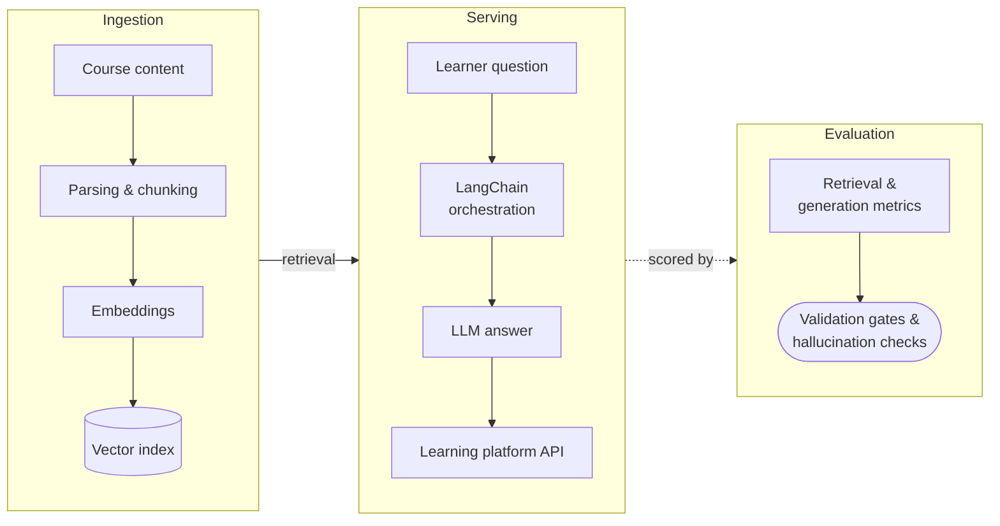

# RAG AI Tutor & LLM Evaluation Framework

!!! abstract "Case Study Summary"
    **Organization**: Emeritus  
    **Industry**: EdTech / Higher Education  
    **Role**: Senior Data Scientist  
    
    **Impact Metrics**:
    
    - Evaluation framework that secured **enterprise AI contracts with Stanford, MIT and Berkeley**
    - **AI Tutor** in production, answering questions from learners on live university courses
    - Automated validation gates and **hallucination-risk controls** aligned to academic-integrity requirements

Universities hold their programs to a high standard of academic integrity. Before they would put an AI assistant in front of their learners, they needed evidence that it would answer accurately, stay grounded in course material and not make things up.

## Challenge

There were two problems to solve together:

1. **Build a tutor learners can trust.** Answer questions about unstructured course content quickly, accurately and at a sustainable inference cost.
2. **Prove it.** Give university partners a rigorous, repeatable way to measure answer quality and hallucination risk, tied to their own objectives.

## Approach

**LLM/RAG evaluation framework.** I engineered a Python evaluation framework with:

- Retrieval metrics (is the right course content being found?) and generation metrics (is the answer correct and grounded?)
- Automated validation gates that block changes that reduce quality
- Hallucination-risk controls aligned to client objectives around academic integrity

This framework became the assurance layer that secured enterprise AI contracts with Stanford, MIT and Berkeley.

**AI Tutor.** I built and shipped a LangChain-orchestrated RAG service:

- Embeddings-based vector retrieval over unstructured course content
- Iterative prompt engineering, measured against the evaluation framework
- Served into the live learning platform via API, balancing answer quality against latency and inference cost

## Solution Overview

## Results & Impact

- Enterprise AI contracts secured with Stanford, MIT and Berkeley, backed by measurable quality evidence.
- AI Tutor in production, serving learners enrolled in university courses such as MIT and Stanford programs.
- A repeatable evaluation process, so every prompt or retrieval change is validated before it ships.

## Tech Stack

- Python
- LangChain
- Sentence embeddings and vector search
- LLM evaluation (retrieval and generation metrics)
- API-based serving into the learning platform
- Google Cloud Platform

!!! tip "Related reading"
    Most RAG quality problems start before retrieval, at the parsing layer. I wrote about this in [Garbage In, Garbage Retrieved: Why Parsing Is the RAG Layer You're Underfunding](../../blog/posts/rag-parsing-layer.md).

-   :material-coffee:{ .lg .middle } Let's have a virtual coffee together!

    ---
    
    Want to see if we're a match? Let's have a chat and find out. Schedule a free 30-minute session to discuss your data and AI challenges and explore how we can work together.

    [Book Free Intro Call :material-arrow-top-right:](https://calendly.com/umarvinci/introduction-call){ .md-button .md-button--primary }

