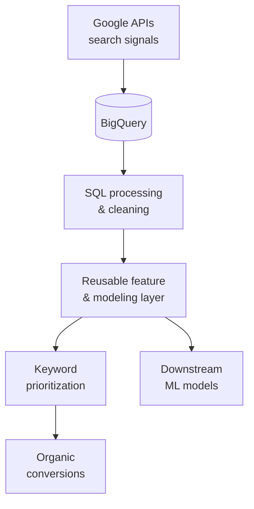

# Search-Signal Data Pipeline: $350K in Conversion Value

!!! abstract "Case Study Summary"
    **Organization**: Emeritus  
    **Industry**: EdTech / Digital Marketing  
    **Role**: Senior Data Scientist  
    
    **Impact Metrics**:
    
    - **$350,000** in organic conversion value
    - A reusable feature and modeling layer that other models can build on
    - Systematic, data-driven keyword monetization instead of ad-hoc choices

People searching for programs leave behind strong signals of what they want. Those signals were valuable, but they weren't being captured at scale or in a form that models and marketing teams could use.

## Challenge

Build a dependable way to ingest and process high-intent search signals at scale, then turn them into something the business could act on: which keywords and topics to invest in, and how to convert that organic interest into enrollments.

## Approach

I architected an end-to-end data pipeline:

- **Ingestion** of high-intent search signals through Google APIs
- **Processing at scale** in SQL and BigQuery
- A **reusable feature and modeling layer**, so search signals become inputs for downstream models, not one-off reports
- **Systematic keyword monetization**, prioritizing the opportunities with the highest conversion value

## Solution Overview

## Results & Impact

- $350,000 in organic conversion value generated through systematic keyword monetization.
- A shared feature layer that made search intent available to other models and analyses.

## Tech Stack

- SQL
- Google BigQuery
- Google APIs
- Python (Pandas)
- Google Cloud Platform

-   :material-coffee:{ .lg .middle } Let's have a virtual coffee together!

    ---
    
    Want to see if we're a match? Let's have a chat and find out. Schedule a free 30-minute session to discuss your data and AI challenges and explore how we can work together.

    [Book Free Intro Call :material-arrow-top-right:](https://calendly.com/umarvinci/new-meeting){ .md-button .md-button--primary }

